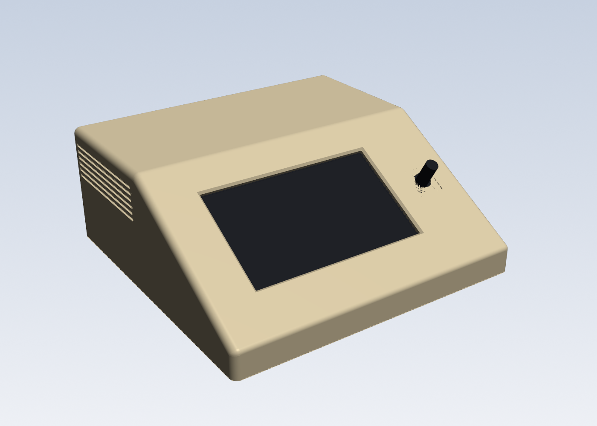
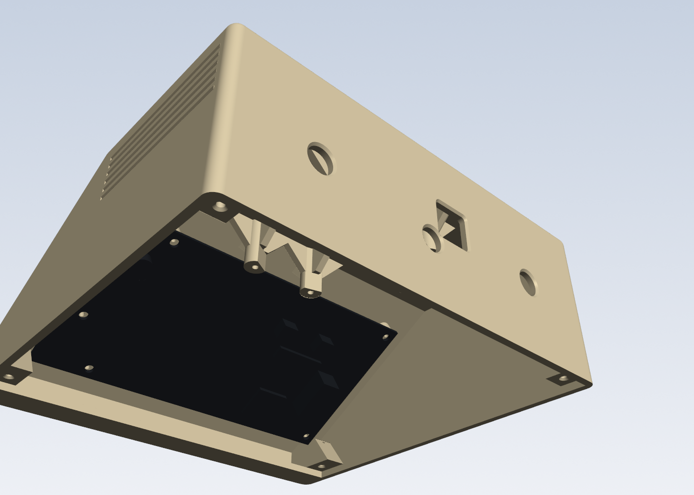
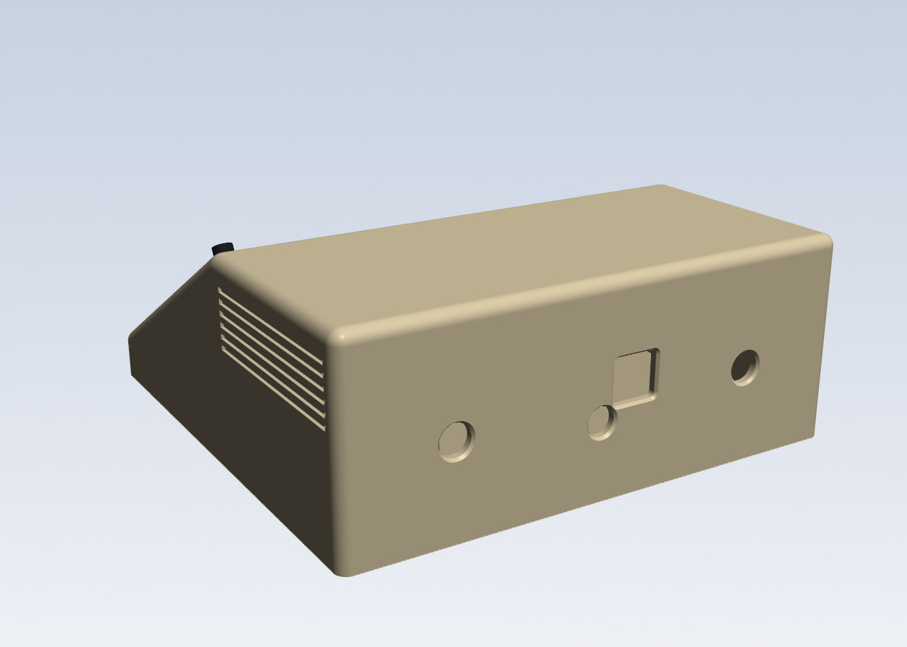

# drum-amp-jukebox case: Ender-3 V2 display + Arduino Uno + Music Maker

> **The case to print is mikeoverbay's Shapr3D edit:** `stl/hood.stl`, `stl/bottom_cover.stl` and `case_assembly.step`, exported 2026-10-22. He trimmed the inside corners of some Uno standoffs to clear the sockets' solder pins.
> `console_case.py` is the parametric source of the base design, which the 4560 cap session keeps in `Desktop\mini-4560\coffee player STEPs`. It doesn't have his trims yet, and it writes to `generated/` so it can't overwrite them.
>
> **Known issue in this version:** the Uno screw hole by the power jack is at (15.24, 3.71), taken from the wrong Uno model. Arduino's official position is 1.7 mm away, at (13.97, 2.54). Three screws line up. For the fourth, drill a 2.5 mm pilot through the Uno's hole into the same standoff, or use the corrected version when it lands.
> **Uno holes:** use Arduino's official UNO R3 positions, (13.97, 2.54), (15.24, 50.80), (66.04, 7.62) and (66.04, 35.56) mm, not the `reference/arduino_uno_r3.step` model, which is wrong. The STEP model is for looks only.

This is a 3D-printable sloped console in the style of a classic electronics enclosure, with Apple II touches. It holds:
- the Ender-3 V2 DWIN screen, landscape, with the knob on the right and the screen tilted 30° up from the desk;
- an Arduino Uno with an Adafruit Music Maker shield plugged straight on.

**Size:** 169.1 W x 167.1 D x 66.0 H mm.

## Files

| File | What it is |
|---|---|
| `console_hood.step` | Hood: sides, front lip, sloped screen face, top deck and back wall in one piece. The screen and the Uno stack both mount on it |
| `console_bottom_cover.step` | The bottom cover: a 3 mm plate held by 4 screws from below. It comes off without disturbing any wiring |
| `console_assembly.step` | Both parts assembled, plus the display model (`DisplayV2.step`), your Uno model (`reference/arduino_uno_r3.step`, for looks only) hanging on its standoffs, and placeholder boxes for the Music Maker and the jack bodies |
| `console_case.py` | Parametric CadQuery source. Run `python console_case.py` to regenerate |
| `previews/` | Renders and section views |

The matching STLs for printing are in `..\coffee player STLs\`.

Parts are exported in their assembled position:
- X is width, centred.
- Y is depth, with the front at Y = 0.
- Z is up.

## Hood

- 15 mm vertical front lip, a 102 mm slope at 30°, and a 79 mm flat deck.
- **The Uno stack hangs upside down under the deck**, so it and the screen are both on the hood, which makes wiring easier.
  - It hangs on four 9 mm D-shaped standoffs **20 mm long**. Their ends, where the Uno screws on, are **40 mm above the inside of the floor**; `UNO_FLOOR_H` sets that, and the standoff length follows from it. The 24 mm stack ends 16 mm above the floor.
  - **Mounting holes:** the hole beside the power jack comes from your Uno STEP model: 15.24 mm from the USB end, 3.71 mm from the power-header edge. You confirmed it with calipers on your board. Arduino's drawing has it at 13.97, 2.54. The other three agree in both.
  - The standoffs are in the Uno R3 hole pattern. Each flat sits 2.5 mm from its hole, facing the Uno's centre. 
  - **Gussets:** each standoff has four 3 mm ribs up to the deck (or to the slope, for the front pair), with 45° undersides. They cover the top 12 mm of each standoff, ending 8 mm above the Uno's board, and stay at least 3.9 mm from the screen's parts. They stop the standoffs snapping or pulling out. `RIB_T`, `RIB_REACH` and `RIB_CLEAR` set them.
  - The standoffs have 2.5 mm pilot holes, 5.8 mm deep from the free end, for **3 x 6 mm** wood screws: 4.4 mm of thread in the plastic after the 1.6 mm board. Above the pilot, each standoff is solid up to the deck, with at least 8.4 mm of plastic to the outside. `HANG_PILOT` sets the depth.
  - The front two standoffs are trimmed to the shell where they run into the slope, so nothing shows on the outside.
  - The stack hangs mirrored, with its USB still facing the back. The Music Maker is at the bottom of the stack.
  - The script places it automatically, behind the screen's top edge. The long front standoffs reach down past the display board's top edge, so they're set back far enough for the screen to come out past them with 1 mm to spare (`PATH_CLEAR`). That sets the depth, 167.1 mm. Where the screen sits, they're 5.4 mm from its parts.
  - The round side of the standoff at the digital-header corner reaches toward the header's first pins. Check it doesn't press on a solder joint.

- **The back wall is part of the hood**, so the hood stands on its flat back. It carries the plug holes and the 1/4" jack holes (see below).
- **Bottom-cover screw blocks**, all at floor level:
  - two behind the front lip;
  - two in the back corners, against the side and back walls. These are wedges, tallest at the side wall, with 45° undersides so they print without support.
  - All four are 13 mm tall with Ø2.5 pilots and a 0.8 mm 45° lead-in.
- Rounded edges:
  - R4 on the sides, the two back corners and the deck-to-back edge;
  - R6 at the ridge, R3 at the lip;
  - the bottom edges stay square, so it sits flat.
- The slope is one flat face with the screen window, the knob hole and the board posts built in.
- Apple II detail: side vent grooves. The deck is plain.
- The vent grooves are 1.6 mm tall at the surface and 1 mm deep. Each has a flat bottom and a top that slopes at 45° into the wall, so they print upright without support.

## Display mounting

- The bare display board screws to 5 posts behind the screen face, using **M2.5 x 8 self-tapping screws**. The board holes are 3.0–3.1 mm, too tight for M3; the posts have Ø2.1 pilot holes.
- The 5th post sits beside the knob and takes the load when you press it.
- The LCD sits 0.2 mm behind the face.
- The screen window is 98.5 x 57.3 mm, 0.4 mm beyond the visible screen area on each side, with a 1.2 mm chamfer on the front. `WINDOW_INSET` sets this: negative opens it up, positive closes it in.
- The knob shaft (Ø6.7) comes through a Ø9.5 hole, leaving 1.4 mm of clearance all round; the knob covers it. A 17 x 17 mm pocket behind the face clears the encoder body by 2.5 mm all round, and stops 1 mm short of the post beside the knob. It's 2.1 mm deep, leaving 0.9 mm of face over the encoder.
- The shaft sticks out 12.8 mm past the face. With the knob fitted, its underside clears the face by 2.9 mm (calipers).
- This layout matches the separate test panel that you test-fitted to the screen, apart from the window, which was opened up 1 mm on each side afterwards.

**Display board dimensions used** (front side, knob on the right, mm from the bottom-left corner):

| | Value | Source |
|---|---|---|
| Corner hole spacing | 114.9 x 66.2 | calipers |
| Corner holes | (3.49, 3.85), (3.49, 70.05), (118.41, 3.85), (118.41, 70.05) | measured spacing, centred where the CAD model puts the pattern |
| Hole beside the knob | (132.41, 26.0) | calipers |
| Knob centre | (132.41, 39.0) | x by calipers; y level with the screen centre, from both CAD models |
| Visible screen area | 12.2–109.9 x 11.2–67.7 | `DisplayV2.step` |

**Installing the screen:**
1. Take the bottom cover off and lay the hood on its back.
2. Feed the board in through the open bottom, screen first.
3. Push it straight out toward the slope until the knob shaft is through its hole and the board sits on the 5 posts.
4. Screw it down from inside with M2.5 screws, then plug in the ribbon.

The model checks this path: moving the board, LCD, knob shaft and back-side parts 60 mm along it, from installed to fully out through the bottom, they never touch the hood.

**Assembly order: screen first, then the Uno stack.**
1. Fit the screen.
2. Screw the Uno up to its standoffs from below.
3. Plug the Music Maker into it.

The model checks this: the stack lifts straight up into place past the mounted screen. Done the other way round, the screen hits the stack after 15 mm of its path. So to service the screen later, take the stack out first.

## Back wall and bottom cover

The back wall is part of the hood, and the **bottom cover** is a 3 mm plate that fits inside the walls. The screen and the Uno stack stay on the hood, so the cover comes off without unplugging anything.
- **Fixing:** 4 x **3 x 14 mm countersunk wood screws** up through the cover:
  - two into the blocks behind the front lip;
  - two into the blocks in the back corners, 5 mm in from the side and back walls.
  - Each screw goes 11 mm into its block. That leaves at least 3 mm of plastic above the pilot at the back and 4.4 mm at the front, and 3 mm to the outside.
- **Plug holes** in the hood's back wall, where the stack's plugs are, scaled from your photo of the stack, then moved 3.22 mm left and 0.95 mm down after you checked them against the real stack, and 0.68 mm back right to match your 84.04 mm USB measurement (`BACK_PLUGS`). Seen from the back, with the console sitting flat:
  - **Uno USB:** 15 x 14.4 mm, centred 8.5 mm right of centre and 35.25 mm up. The socket's left side is 84.04 mm from the hood's inside left wall, as you measured.
  - **Music Maker headphone jack:** Ø9 mm, centred 2.7 mm left of centre and 24.45 mm up. There's 1.3 mm of plastic between it and the USB hole.
  - Both are bigger than the sockets so the plug bodies fit: the wall is 3.5 mm out from the USB socket and about 10 mm from the headphone jack.
  - The Uno's power jack, the microSD card and the screw terminals have no hole; take the bottom cover off to reach them.
- **Chamfers:** every back wall hole has a 0.8 mm 45° chamfer on its outside edge (`HOLE_CHAMFER`).
  - The inside face stays flat for the 1/4" jack frames. Outside, the jack nut's washer covers the chamfer and still sits flat.
  - The USB and headphone chamfers meet in the outer 0.16 mm of the 1.3 mm strip between those two holes. Below that the strip is whole.
- **Two 1/4" jack holes, Ø9.8 mm**, in the hood's back wall, for Switchcraft-style open-frame mono jacks.
  - Their 3/8"-32 bushing is 9.53 mm; the extra allows for printed holes coming out small.
  - They sit at X = ±50 mm, 30 mm up, either side of the plug holes.
  - The jack bodies are 19 mm across and 30 mm long. They clear the stack by 13 mm and the back-corner screw blocks by 11 mm.
- **Feet:** recesses under the bottom cover, Ø10 x 1 mm.

## Automatic sizing

The front lip height and the case depth are calculated from where the screen and the stack sit:
- The display's ribbon plug must clear the floor. It clears by 4.5 mm.
- The hanging Uno stack (24 mm, plus 20 mm standoffs) and its standoffs must clear the screen's parts by at least 3 mm, and the standoffs must clear the screen's way out by 1 mm. That way out sets the depth; the stack clears the screen by 10 mm. The Uno's back must also clear the inside of the slope by 1 mm.

## Checks run

- **Both parts** are valid single solids.
- **No overlaps** between the hood, bottom cover, display, stack placeholder or jack bodies.
- **Board posts** touch the board exactly.
- **Insertion path** for the screen is clear, fitting the screen before the stack.
- **Standoff pilots** leave at least 15 mm of plastic to the outside, and nothing sticks out of the shell.
- **The stack** lifts straight up into place past the mounted screen.
- **Gussets** stay at least 3.9 mm from the screen's parts, and the screen's path in still clears them.
- **Back wall holes** go clean through at each plug and jack. Their chamfers are on the outside only.
- **Your Uno model** sits by its mounting holes: all four land on the standoff pilots (within 0.04 mm), its board touches the standoff ends, and it doesn't touch the hood, bottom cover or screen. Its USB socket's left side comes out 84.07 mm from the hood's inside left wall, against your 84.04. The socket is 12.8 mm wide, centred 0.44 mm right of the hole's centre, and fits with 0.65 mm to spare on that side.
  - The model's USB and power jack are 12.5 mm tall, taller than the real ones in your photo, so in the assembly they reach about 1 mm into the Music Maker box. The real ones fit under the Music Maker.
- **Bottom-cover screws:** every cover hole lines up with its pilot. The 14 mm screws stop 1 mm short of the pilot ends.
- **Front blocks** stay 1.05 mm to the side of the screen. It moves straight in and out, so its path stays clear too.
- **The STEP files** read back as single solids.

## Printing

The STEP files are in the upright orientation, as the case sits.
- **Hood upright, with supports:** supports go under the deck, inside the slope, around the 5 board posts and under the 4 hanging Uno standoffs (20 mm long) and their gussets. They come out through the open bottom. The vent grooves need none. Bed: 169 x 167 mm, 66 mm tall.
- **Hood standing on its flat back** also works now that the back is part of it. Bed: 169 x 66 mm, 167 mm tall.
  - The Uno standoffs then stick out sideways and need supports.
  - So do the slope and the deck's underside.
  - The vent grooves' 45° side faces up.
- **Hood face down** (deck on the bed) also works:
  - The Uno standoffs then point straight up and need no support; their gussets' 45° faces print without it too.
  - The vent grooves' flat side becomes a 1 mm overhang.
  - The slope and the front lip then need supports.
- **Bottom cover:** flat, countersinks down. Bed: 163 x 149 mm, 3 mm tall.

## Hardware

| Use | Parts |
|---|---|
| Display | 5 x M2.5 x 8 self-tapping screws |
| Uno | 4 x 3 x 6 mm wood screws up into the hanging standoffs (no longer than 6 mm) |
| Bottom cover | 4 x 3 x 14 mm countersunk wood screws |
| Jacks | 2 x Switchcraft-style 1/4" mono open-frame jacks |
| Feet | 4 rubber feet, up to Ø10 mm |

## Settings to adjust (top of `console_case.py`)

- **Display holes:** `BOARD_HOLES`. The corner holes' distance from the board edges is assumed: the measured spacing, centred where the CAD model puts the pattern.
- **Stack height:** `STACK_BODY_H`, from the Uno's underside to the top of the Music Maker's screw terminals (24 mm, from your photo). Add about 12.5 mm per extra shield.
- **How low the stack hangs:** `UNO_FLOOR_H`, the standoff ends above the inside of the floor (40 mm).
- **Plug holes:** `BACK_PLUGS`, each plug's position across the Uno and height above it, with the hole size. `HOLE_CHAMFER` sets the outside chamfer.
- **Jacks:** `JACK_D`, `JACK_XS`, `JACK_Z`.
- **Look:** `TILT`, `FRONT_H_MIN`, `R_SIDE`, `VENT_N`, `SCREEN_MARGIN`.
- **microSD:** the card slot is on the stack's back edge but has no hole; take the bottom cover off to swap cards.

## Electronics notes

- **Stack:** the Uno against the standoffs, with the Music Maker plugged straight on below it (no proto shield, as in your photo). Its headphone jack lines up with the back wall's round hole.
- **Power:** the only way in now is the USB hole, so the stack runs on USB power. That's fine for line out to the drum amp. The Music Maker's own amp at volume plus the display backlight would be too much for USB. For a separate regulated 5 V (2–3 A) supply, a power hole is needed: ask 4560 cap.
- **Audio out:** the board is the Music Maker **without** the amp. Its line out (the tip) feeds the Donner DDA-80's 1/4" input. Mono is a runtime setting in the sketch (`setMono()`), using the VLSI patches.
  - **Caution (from the Arduino session):** on this board the jack's sleeve is **GBUF (1.25 V), not ground**.
  - So **don't wire the 1/4" jack sleeves to the Arduino ground** unless the Arduino's supply is isolated from the amp. Otherwise GBUF gets shorted to ground.
- **Knob:** wired to **A0/A1** (A/B, pin-change interrupt) and **A2** (push), per the Arduino session.
- **Display serial:** the display is on the Uno's hardware serial (D0/D1). Unplug it while uploading code.
  - It now runs at **489600 baud**: the display's `T5UIC1.CFG` was changed, and the Uno uses `Serial.begin(500000)`.
  - The firmware is in `Documents\Arduino\coffee_player`, owned by the Arduino session. Debug output there is behind a `DEBUG_SERIAL` switch.
