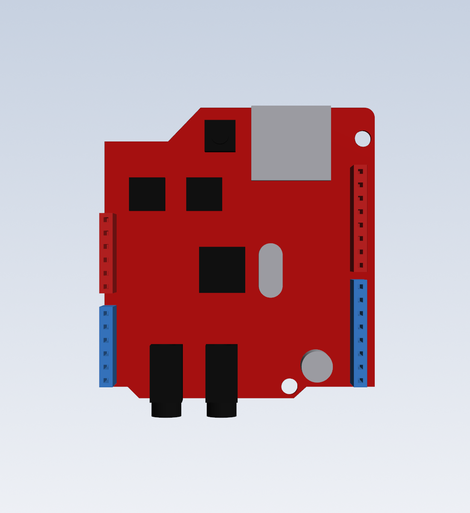
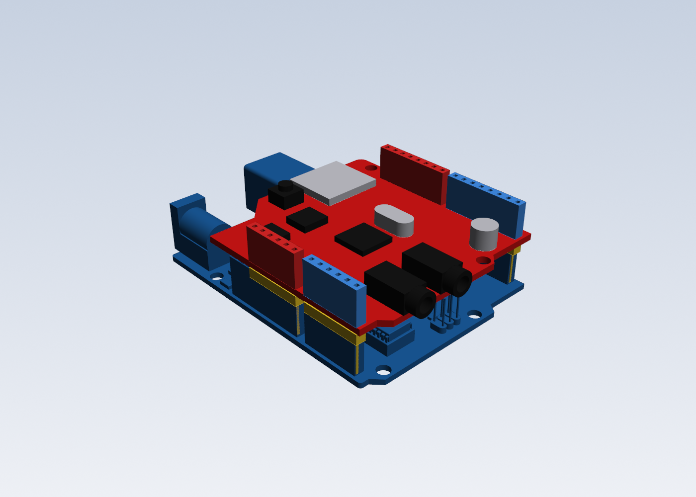

# HW-261 VS1053 MP3 shield model (drum player only)

This is a 3D model of the red "VS1053 MP3 Shield" (HW-261) used in the drum-amp MP3 player. It was built for fit checks in the drum case. The console case doesn't use it.

## Files

| File | What it is |
|---|---|
| `vs1053_hw261_shield.step` | The shield on its own, with coloured parts |
| `uno_vs1053_stack.step` | Your Uno model (`Desktop\STEP files\ARDUINO UNO R3 Step.STEP`) with the shield plugged on |
| `vs1053_shield.py` | CadQuery source. Run `python vs1053_shield.py` to regenerate both files |
| `previews/` | Renders |

## Coordinates

The model uses the same coordinates as Arduino's Uno drawing, in mm:
- X runs from the Uno's USB end.
- Y runs from the power-header edge.
- Z = 0 is the bottom of the shield's PCB.

On the Uno, the shield's PCB sits 11 mm above the Uno's: 8.5 mm sockets plus 2.5 mm yellow spacers.

## How it was measured

The model comes from the product photos you sent.
- **Scale:** set from the header sockets, at 16.46 px/mm. The header pins sit exactly on the standard Uno grid, so the shield plugs onto the Uno model properly.
- **Everything else:** good to about ±1 mm.
- **Cross-check:** your front/back photo agrees on the outline and on both mounting holes.

## What to know about this board

- **The jacks face the Uno's far end**, the end opposite its USB socket. The headphone jack is 13.7 mm from the power-header edge, and the mic jack is 24.4 mm. Both stick out 2.35 mm past the end of the Uno. In a case laid out like the console, with the USB at the back, the jacks point toward the front.
- **The microSD card goes in from the USB end.**
- **Mounting holes:** the shield's holes are at (16.9, 52.1) and (65.5, 37.7), not on the Uno's hole positions. Use the Uno's holes for screws.
- **Board position:** the board sits about 1.2 mm toward the digital-pin side of the Uno, and overhangs that edge by about 1 mm.
- **USB end:** the shield is cut back there. It clears the Uno's USB socket by 0.5 mm, and the power jack completely.
- **Tallest parts:** the stacking sockets, 8.5 mm above the board. The jacks are 5 mm, the mic 5 mm, the crystal 3.6 mm.
- **Model quirk:** your Uno model's sockets are about 9 mm tall where real ones are 8.5. In `uno_vs1053_stack.step` the yellow spacers sink 0.5 mm into them.

